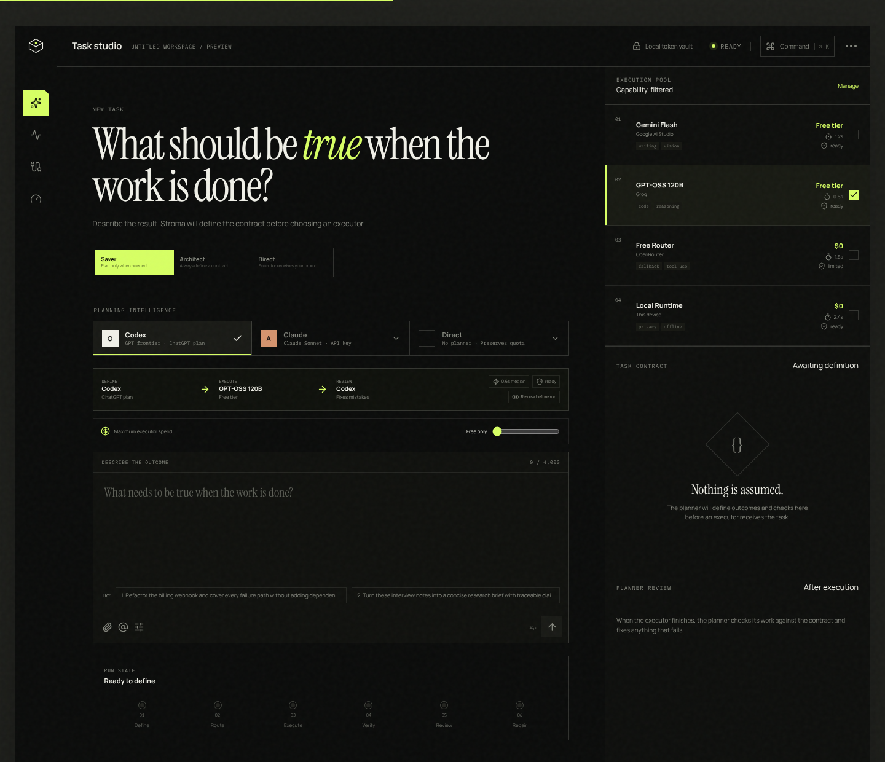
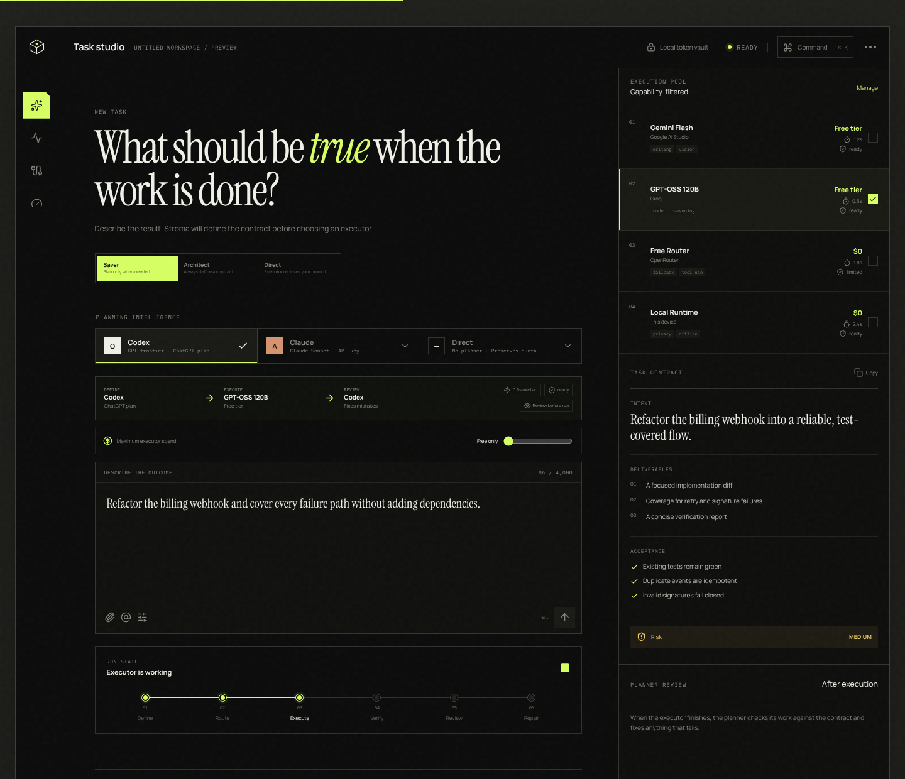
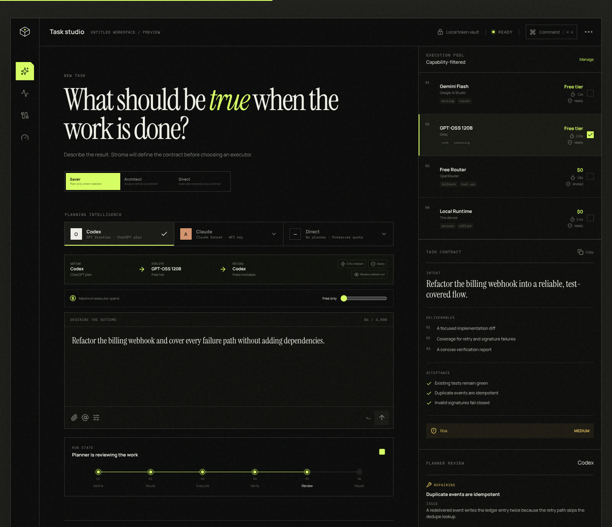
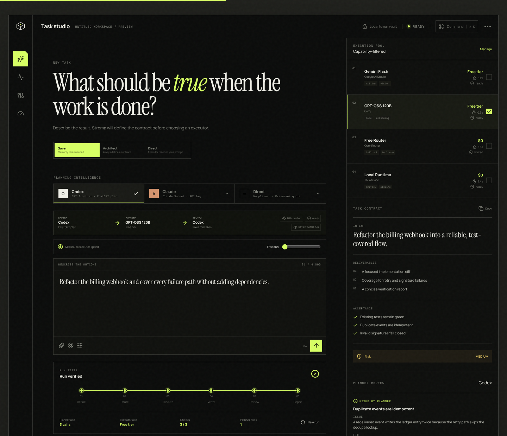
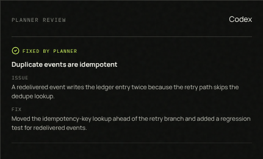
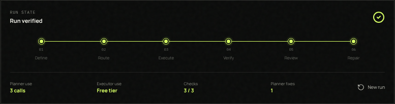

# Stroma

**Think once. Run light.** · [Live demo](https://flotrpy.github.io/Stroma/)

Stroma is a local-first interface that splits AI work between two kinds of model:

- **A frontier planner** from a paid subscription (Codex on a ChatGPT plan, or Claude via API key). It plans the task, then reviews and fixes the result.
- **A low-cost executor**, often a free one (GPT-OSS 120B on Groq, Gemini Flash, OpenRouter's free router, or a model running on your own device). It does the actual work.

Planning and reviewing need judgment. Typing out the implementation mostly needs throughput. Stroma uses the expensive model only for the first two, so your paid quota lasts much longer and the result is still checked by a capable model.


---

## How it works

Every run passes through six stages. You can watch them advance in the studio's run tracker.

| # | Stage | Who does it | What happens |
|---|-------|-------------|--------------|
| 01 | **Define** | Paid planner | Turns your request into a *task contract*: intent, deliverables, constraints, required capabilities, risk, and acceptance tests. One bounded call. |
| 02 | **Route** | Stroma | Filters the execution pool by capability (tools, context, privacy, output format) and picks the cheapest model that can do the job. |
| 03 | **Execute** | Free / small executor | Does the work against the contract. The executor gets a precise spec instead of a vague prompt. |
| 04 | **Verify** | Acceptance checks | Runs the contract's acceptance tests against the executor output. |
| 05 | **Review** | Paid planner | Audits the executor's work against the contract and the check results. Each failed check becomes a finding. |
| 06 | **Repair** | Paid planner | Fixes each finding, then re-runs the checks. Skipped when the review finds nothing. |


### 1. The paid planner plans the task

Write what should be true when the work is done, then pick a planning mode and a planner:

- **Saver**: plan only when needed.
- **Architect**: always define a contract.
- **Direct**: send your prompt straight to the executor.

The route preview shows exactly which model will **Define**, **Execute** and **Review** before anything is spent.



When you submit, the planner writes the task contract shown in the right-hand panel. For the demo prompt *"Refactor the billing webhook and cover every failure path without adding dependencies"*, the contract has three deliverables, two constraints (no new dependencies, keep the public handler contract) and three acceptance tests:

- Existing tests remain green
- Duplicate events are idempotent
- Invalid signatures fail closed

### 2. The free model does the work

Stroma routes the contract to the selected executor, GPT-OSS 120B on Groq's free tier in this example. The execution pool on the right shows each executor's strengths, cost, latency, privacy and status, so you can always see why a model was chosen.



### 3. The paid planner checks the work and fixes mistakes

Small models are cheap but make mistakes, so Stroma never ships executor output unchecked. After the acceptance checks run, the planner reviews the work:

- **Clean output:** the planner accepts it as-is. That is 2 planner calls in total: define and review.
- **A check failed:** the planner records a finding (which check, and what went wrong), writes the fix, and re-runs every check. That is 3 planner calls in total: define, review and repair.
- **No planner connected (Direct):** there is nothing to repair with, so failures stay **open** and the run is marked *Needs human review* rather than verified.

In the demo, the executor's first pass breaks idempotency: a redelivered webhook writes the ledger entry twice because the retry path skips the dedupe lookup. The planner catches it during review…



…then repairs it and re-runs the checks before the run is marked verified:



The **Planner review** panel shows each finding, and the run receipt shows what the run cost:

| Planner review | Run receipt |
|---|---|
|  |  |

The receipt reports planner calls, executor tier, checks passed, and how many mistakes the planner fixed. The paid model spent three short, high-leverage calls; the free model did the bulk of the generation.

### Where the logic lives

| File | Responsibility |
|------|----------------|
| [`src/lib/review.ts`](./src/lib/review.ts) | `reviewExecution()`: the planner's review-and-repair pass. It turns failed checks into findings, applies repairs, and counts planner calls. |
| [`src/hooks/useRunSimulation.ts`](./src/hooks/useRunSimulation.ts) | `runRoute()`: decides which stages a run passes through. Review and repair only appear when a planner can do them. |
| [`src/data/demo.ts`](./src/data/demo.ts) | The demo contract, the executor's first-pass output, and the planner's repairs. |
| [`src/components/studio/ReviewPanel.tsx`](./src/components/studio/ReviewPanel.tsx) | Displays findings as *Repairing*, *Fixed by planner* or *Open*. |
| [`src/components/studio/RunSummary.tsx`](./src/components/studio/RunSummary.tsx) | The six-stage run tracker and receipt. |

`reviewExecution()` takes a `RepairStrategy` callback. A real provider integration replaces the demo lookup with a planner call that receives the contract, the executor's diff, and the failing check output.

---

## Development

```bash
npm install
npm run dev
```

## Production checks

```bash
npm run typecheck
npm run test
npm run build
# or all three:
npm run check
```

The current implementation is a front-end product prototype. Provider connections and run data are simulated, and labelled as preview data, until backend credentials and account integrations are configured.

## Product standards

- [Design direction](./DESIGN.md)
- [Interface architecture](./docs/ARCHITECTURE.md)
- [Research rationale](./docs/RESEARCH.md)
- [Accessibility contract](./docs/ACCESSIBILITY.md)
- [Security boundary](./docs/SECURITY.md)
- [Release quality plan](./docs/QA.md)
